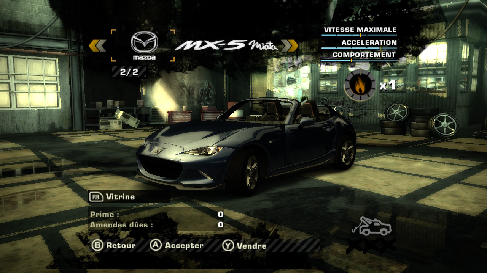

# Mazda MX-5 RF (ND) in racing games

🇫🇷 [Version française](README.md)

I love this car. The project: **bring it into the racing games I love** so I can drive it,
across **several console generations**, from the PS1 to the Xbox 360.

The car: a Mazda MX-5 RF (ND2) 2.0 184 hp in **Deep Crystal Blue**, gloss black roof, dark
wheels and red Brembo calipers.



## Build the car in one click

**➜ [soaresden.github.io/MazdaMx5-nd-rf-ingames](https://soaresden.github.io/MazdaMx5-nd-rf-ingames/)**,
the project hub, with one page per game (for now:
[Need for Speed Most Wanted](https://soaresden.github.io/MazdaMx5-nd-rf-ingames/web/nfsmw.html)).
Both pages have a 🇫🇷 / 🇬🇧 switch.

Each page builds the car **in your browser**, from **your** files. Nothing is sent over the
internet, and this repository holds **no game file and no 3D model**.

1. Pick your disc image of the game and the Assetto Corsa model (see below).
2. Choose the car to replace, the roof (closed or open), the engine sound, the performance,
   the logo, and optionally your own badge for the name.
3. Click **Build**: within one or two minutes the page gives you a `.zip` with a `game_root/`
   folder to copy to the SD card, and a `LISEZMOI.txt`.

## The games

| Game | Platform | Car replaced | Status |
|---|---|---|---|
| [Need for Speed: Most Wanted (2005)](games/nfs-most-wanted-x360/) | Xbox 360, on Switch with [nfsmw-nx](https://github.com/StevensND/nfsmw-nx) | your choice (tested: Lexus IS 300) | **works** |
| [Gran Turismo](games/gran-turismo-ps1/) | PS1 (PAL), .bin/.cue image for DuckStation | the Eunos Roadsters (new, used) | **testing** (works in game) |
| [Need for Speed: Underground](games/nfs-underground-xbox/) | Xbox USA, on Switch with [nfsu1-sw](https://github.com/antoxa2584x/nfsu1-sw) | Mazda Miata | **testing** |
| [Need for Speed: Underground 2](games/nfs-underground-xbox/) | Xbox USA, on Switch with [nfsu2-sw](https://github.com/antoxa2584x/nfsu2-sw) | Mazda Miata | **testing** |
| Need for Speed: Carbon | to be decided | — | planned |
| Gran Turismo 2 | PS1 | — | planned |

### Need for Speed: Most Wanted, what the conversion does

- **Model**: the detailed Assetto Corsa model (211,000 triangles), reduced below the engine's
  limits (8,500 triangles per part) with five levels of detail, cockpit and driver included.
- **Roof**: RF closed, or open (roof panels and rear window stowed, windows down).
- **Menus**: Mazda logo and "MX-5 Miata" name in place of those of the replaced car.
- **Tuning**: the game's hoods and body kits are replaced by the MX-5 body.
- **Performance**: an MX-5 RF 2.0 184 hp (1,125 kg, 6-speed, 7,500 rpm redline, limited-slip
  differential).
- **Sound**: the game holds a **Mazda Miata** recording that no car uses; the MX-5 takes it.
- **Paint**: from the game's paint shop. The closest to Deep Crystal Blue is **Metallic no. 75**.

The technical details (formats, engine limits, what was learned on the Switch) are in
[games/nfs-most-wanted-x360](games/nfs-most-wanted-x360/) (in French).

## What you need

- **Your copy of the game**, as a disc image (for Most Wanted: the Xbox 360 image, `.iso`).
- **The model**: the Assetto Corsa mod **`ks_mazda_mx5_rf`**
  ([Mazda MX-5 RF Hardtop on Modland](https://www.modland.net/assetto-corsa-mods/cars/mazda-mx-5-rf-hardtop.html)),
  extracted; only `mazda_mx5_rf.kn5` is used. It is not provided here.
- For the page: a recent browser (Chrome, Edge, Firefox). For the command line: Python 3.10 or
  newer with `numpy` and `Pillow`:

  ```bash
  pip install -r requirements.txt
  ```

  ```bash
  python games/nfs-most-wanted-x360/make_car.py --iso "NFS Most Wanted (X360).iso" --kn5 mazda_mx5_rf.kn5 --zip mx5.zip --car IS300 --top open --vf
  ```

## The repository

| Folder | Contents |
|---|---|
| `index.html` | the hub: the project and the list of games |
| `web/` | one page per game (`nfsmw.html`…) and the worker running the Python tools in the browser ([Pyodide](https://pyodide.org)) |
| `common/` | shared by all games: Assetto Corsa KN5 reader, model loading, mesh simplification (QEM), a small renderer for previews |
| `games/<game>/` | each game's tools and documentation |
| `docs/` | README pictures |

## Thanks

- **[StevensND](https://github.com/StevensND)** for [nfsmw-nx](https://github.com/StevensND/nfsmw-nx),
  the Switch port of Most Wanted, and its logs that made all the debugging possible.
- **Kunos Simulazioni** for the Assetto Corsa MX-5 RF model (`ks_mazda_mx5_rf`), and
  [Modland](https://www.modland.net/assetto-corsa-mods/cars/mazda-mx-5-rf-hardtop.html) for hosting it.
- **[x07x08](https://github.com/x07x08)** for [nfsmw-save-editor](https://github.com/x07x08/nfsmw-save-editor),
  to which this project added Xbox 360 saves.
- **[sprintstate](https://github.com/sprintstate)** for [nfs-mw-save-editor](https://github.com/sprintstate/nfs-mw-save-editor)
  and its description of the save CRCs.
- **[dbalatoni13](https://github.com/dbalatoni13)** and the contributors of the
  [NFS Most Wanted decompilation](https://github.com/dbalatoni13/nfsmw), which explained how
  parts are unlocked.
- **[vgmstream](https://github.com/vgmstream/vgmstream)** for reading EA's sounds.
- **OfficialWhippy** for the "MX-5" drawing, and the author of the handwritten "Miata", put
  together in the menu badge.

Need for Speed is a trademark of Electronic Arts; Mazda, MX-5 and Miata are trademarks of Mazda
Motor Corporation. Fan project, not affiliated with them.

The code is under the [GPL-3.0](LICENSE) license.
