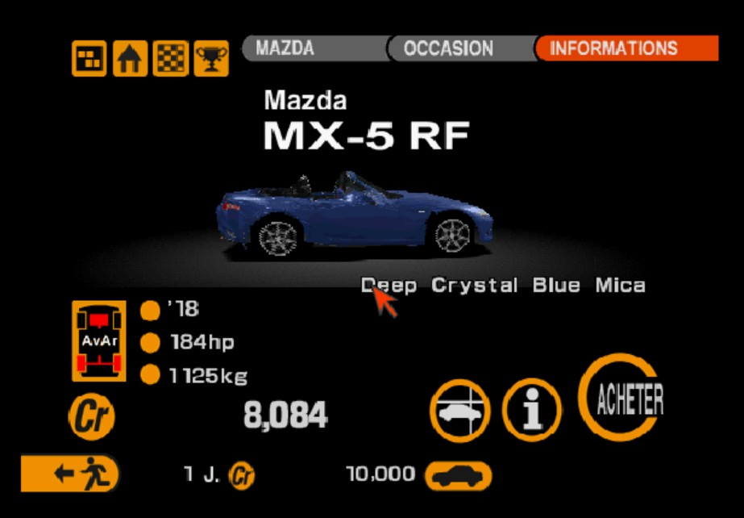
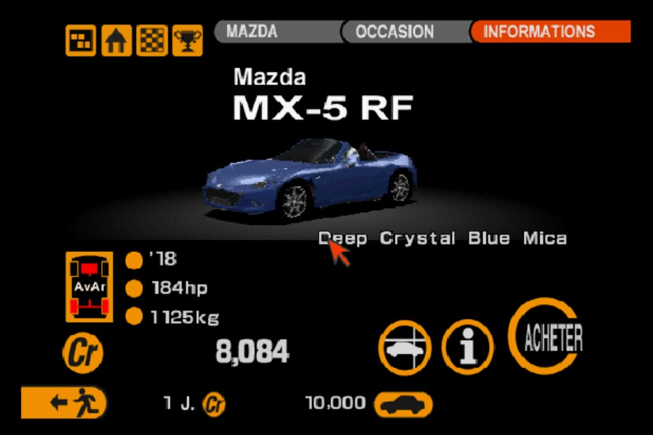
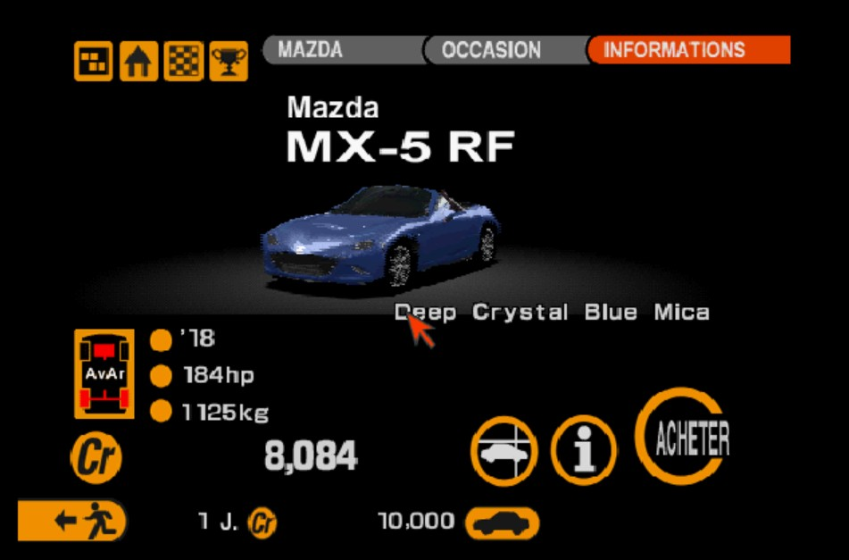

🇬🇧 [English version](README.en.md)

# La MX-5 RF dans Gran Turismo 2 (PS1)



La MX-5 RF (ND2) remplace les MX-5 de ton choix. Par défaut :
- **capotée** à la place de l'Eunos Roadster '93, celle d'occasion à 7 735 Cr ;
- **décapotée** à la place de la V-Special '93. L'annonce d'occasion à 8 084 Cr devient cette décapotée.

Les versions course (après la modification course) sont des RF aussi.

L'outil prend le disque **Simulation** d'origine (Europe), le **disque combiné**
([GT2-Combined-Disc](https://github.com/CookiePLMonster/GT2-Combined-Disc)) ou **GT2 Plus** de
pez2k. Il fabrique l'image sur les trois. Les essais en jeu ont été faits sur GT2 Plus combiné.

 

## Ce que fait la conversion

- **Modèle** : construit à partir du modèle d'Assetto Corsa avec la même méthode que la version
  Gran Turismo, au format de GT2.
  - 3 niveaux de détail, jusqu'à 236 sommets (152 pour la MX-5 '93 du jeu).
  - Un modèle de jour et un modèle de nuit : phares allumés, feux arrière éclairés, feux stop au
    freinage.
  - Passages de roue ronds, faits comme les voitures du jeu : arches transparentes dans la
    texture, paroi noire derrière, et jantes du jeu.
- **Peintures** : 9 couleurs aux noms Mazda (Deep Crystal Blue Mica en premier, Soul Red
  Crystal…), avec les pastilles de couleur des menus.
- **Données** :
  - « Mazda MX-5 RF ND2 '18 » ; la décapotée s'appelle « RF décapotée » en français, « RF Open »
    en anglais, etc. ;
  - 2.0 de 184 ch à 7 000 tr/mn et 20,9 mkg à 4 000 tr/mn, zone rouge à 7 500 tr/mn ;
  - 1 125 kg, boîte 6 ;
  - les pièces de préparation s'ajoutent sur ces valeurs. Le son est celui de la MX-5 du jeu.
- **Menus** :
  - titre « Mazda / MX-5 RF » chez le concessionnaire ;
  - le bouton (i) ouvre deux pages de description de la RF, dans les 5 langues, mises en page
    comme celles du jeu.
- **Écrans de démarrage** : un bandeau dans le style du logo GT, sur l'écran des langues et sur
  les deux écrans titre (sous le copyright, le jeu faisant défiler son choix de mode sous le
  logo). Sur GT2 Plus, il affiche « HD PLUS » avec « beta 7 · MX-5 RF » en dessous ; sur les
  autres disques, « MX-5 RF ».

## Fabriquer l'image

Il faut Python 3 avec `numpy` et `Pillow`, ton image du disque et le fichier `mazda_mx5_rf.kn5`
du mod Assetto Corsa. Rien de tout cela n'est dans ce dépôt.

```
python make_gt2.py --disc "Gran Turismo 2 Plus Combined (Europe).chd" --kn5 mazda_mx5_rf.kn5 --out "GT2 MX-5 RF.chd"
```

- `--car CODE=closed|open` : quelle MX-5 remplacer, et avec quel toit. Répéter l'option pour
  plusieurs voitures. Par défaut : `aminn=closed`, `amivn=open`.
- `--version` / `--version-sub` : le texte du bandeau des écrans de démarrage (`--version ""`
  pour ne rien écrire).
- `--cheat` : ajoute le menu de triche de
  [GranTurismo2-OverlayCheat](https://github.com/soaresden/GranTurismo2-OverlayCheat) (SELECT
  maintenu, ou L1 + R1 + L2 + R2 dans Batocera : chrono des permis figé, crédits en direct). Le projet doit être à côté de ce dépôt,
  ou son dossier donné par `GT2CHEAT_DIR`.
- `--out` en `.bin` donne un `.bin` + `.cue` ; en `.chd`, un CHD directement.

## Comment c'est fait

- `gt2vol.py` : GT2.VOL, l'archive du disque Simulation, lu et réécrit. Le nouveau VOL reste à
  sa place ; s'il grandit, les fichiers qui le suivent sont décalés d'autant.
- `gt2disc.py` : l'image du disque. Les secteurs refaits ont leur EDC et leur ECC recalculés.
- `gt2model.py`, `gt2texture.py` : les modèles `.cdo` / `.cno` et les textures `.cdp` / `.cnp`.
- `build_gt2car.py` : la RF au format GT2. Elle réutilise la coque, les images et la texture de
  la version Gran Turismo (`../gran-turismo-ps1`).
- `gt2data.py` : caractéristiques, noms, peintures (`gtmode_data`, `unistrdb`, `.carinfo`,
  `.carcolor`).
- `gt2menu.py` : écrans de menu (`gtmenudat`), table des descriptions (`solodata`), titres
  (`carlogo`), annonces d'occasion, écrans de démarrage.
- `make_gt2.py` : tout en une commande.

Les formats viennent des outils de [pez2k](https://github.com/pez2k/gt2tools)
(GT2ModelTool, GT2DataSplitter, GT2MenuSplitter, GT2CarInfoEditor) et de nos propres relevés.
