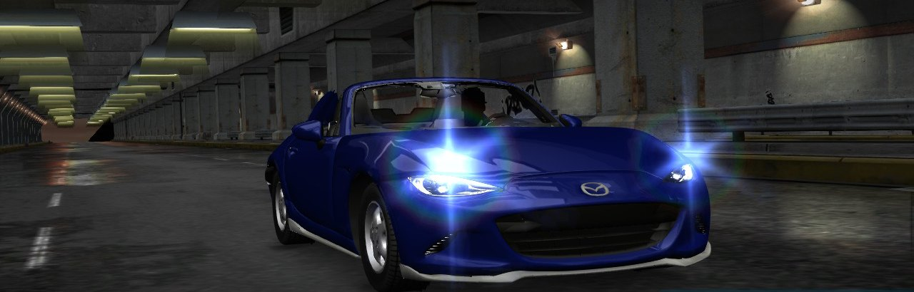
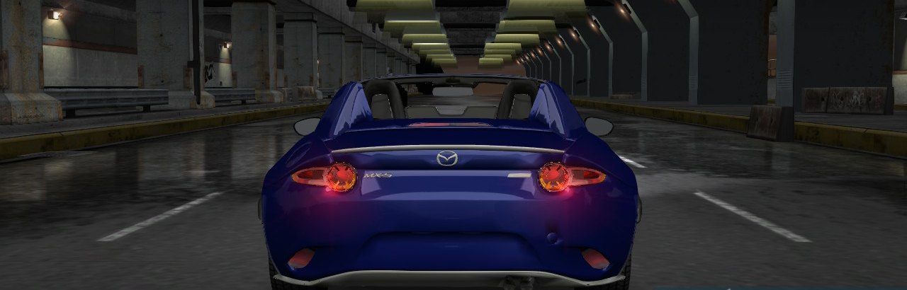
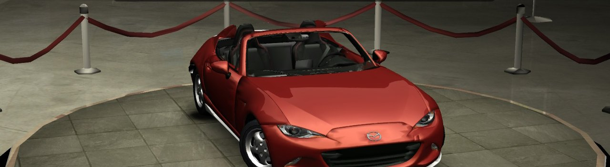
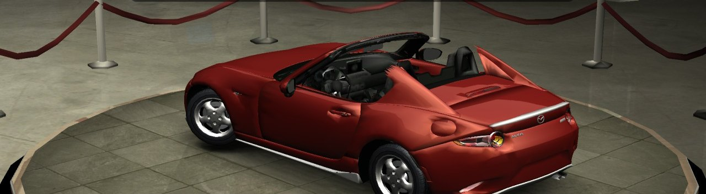
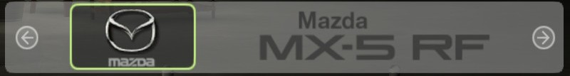

# Need for Speed Underground et Underground 2 (Xbox USA)

🇬🇧 [English version](README.en.md)




**Underground 2** (la voiture est rouge : c'est la couleur de base de la Miata) :





La MX-5 RF remplace la **Mazda Miata**, qui est dans les deux jeux : elle garde son son moteur, sa
marque Mazda et sa place dans le jeu. Pour les portages Switch
[nfsu1-sw](https://github.com/antoxa2584x/nfsu1-sw) et [nfsu2-sw](https://github.com/antoxa2584x/nfsu2-sw),
qui font tourner la version Xbox USA extraite dans `sdmc:/switch/nfsu1x/game/` et
`sdmc:/switch/nfsu2x/game/`.

```bash
python make_car.py --game ug1 --iso "Need for Speed - Underground (USA).iso" --kn5 mazda_mx5_rf.kn5 --zip u1_mx5.zip --top closed
python make_car.py --game ug2 --iso "Need for Speed - Underground 2 (USA).iso" --kn5 mazda_mx5_rf.kn5 --zip u2_mx5.zip --top open
```

- **Underground** : le zip contient `game/CARS/MIATA/GEOMETRY.BIN` et `TEXTURES.BIN`.
- **Underground 2** range ses fichiers dans `NFSUNDER/ZZDATA*.BIN` (index `NFSUNDER/ZDIR.BIN`).
  Le zip contient les deux fichiers en clair (`game/CARS/MIATA/…`) et, dans `planB/`, le
  `ZZDATA2.BIN` du jeu avec la MX-5 à la place de la Miata (mêmes secteurs : les nouveaux
  fichiers sont plus petits) et le `ZDIR.BIN` avec leurs nouvelles tailles.

## Dossier tout prêt pour la carte SD (`make_sd.py`)

Le zip de la release du portage + ton disque USA donnent le dossier `switch/` à copier sur la
carte, avec en option la version française (disque Europe) et la MX-5 RF :

```bash
python make_sd.py --game ug1 --usa "Need for Speed - Underground (USA).iso" --release nfsu1x.zip --out SD                   --europe "Need for Speed - Underground (Europe) (En,Fr,De).iso" --kn5 mazda_mx5_rf.kn5 --top open
```

`--langue fr|de|it|es` choisit la langue avec `--europe` (français par défaut ; Underground 2 :
fr, de, it, le disque Europe n'a pas de voix espagnoles ; l'allemand et l'italien sont à essayer en
jeu). Le paquet Windows (`package/`, `make_package.py`) ouvre une page locale (`ui_server.py`, `package/ui/index.html` : 127.0.0.1 seulement, FR/EN) qui trouve les fichiers, ouvre les fenêtres de Windows et suit la fabrication ; `fabriquer_sd.py ug1|ug2` pose les mêmes questions dans la console. Options : `--nro` (un autre NRO),
`--env` (tes réglages), `--perf`, `--names`, `--no-autoload`. Le dossier de sortie doit être vide :
rien n'est écrit sur une carte déjà installée ni dans les images.

- **Underground** en français : les textes et les voix sont déjà sur le disque USA, il manque
  seulement les cinématiques doublées (`MOVIES/FR*.MAD` du disque Europe). Avec un NRO qui connaît
  `NFSU1_LANGUAGE` ([antoxa2584x/nfsu1-sw#8](https://github.com/antoxa2584x/nfsu1-sw/pull/8)) :
  `NFSU1_LANGUAGE=fr` ; sinon le `default.xbe` USA dont des tables de données font du français
  la langue 0 (`vf_ug1.py`, le code n'est pas touché). `NFSU1_AUTOLOAD=1`
  ([#9](https://github.com/antoxa2584x/nfsu1-sw/pull/9)) quand le NRO le connaît.
- **Underground 2** en français, portage inchangé (`vf_ug2.py`) : `ZZDATA10.BIN` (textes, voix et
  cinématiques françaises du disque Europe), `ZZDATA11.BIN` (les deux fichiers préchargés
  `FrontEndMemoryFile` / `InGameMemoryFile` avec l'index des voix français : avec l'anglais, la
  carrière se figeait après sa première cinématique) et `ZDIR.BIN` qui y renvoie les noms
  anglais (l'original reste en `ZDIR_anglais.BIN`).


## Ce que fait la conversion

Le modèle vient du convertisseur de Most Wanted (`build_mx5.collect` : mêmes pièces, mêmes
matériaux), déplacé pour que ses roues tombent où le jeu met celles de la Miata (CarTypeInfo de
`GLOBALB` : essieux à x = 1,03 et −1,26, centres des roues à z = 0,122). Puis, solide par solide,
sur le fichier de la Miata :

- pièces de série (caisse, base avec l'habitacle et les vitres, capot, phares, feux,
  rétroviseurs) : celles de la MX-5, en trois ou quatre niveaux de détail ;
- carrosseries larges, capots et phares des kits : copies de ceux de la MX-5 ;
- pare-chocs, bas de caisse, toits, ailerons, moteur, échappement, portes (U2) et pièces de
  décalcomanies des kits : un triangle invisible chacun, leurs repères gardés et déplacés
  (échappements, plaque, halos des feux) ;
- roues et freins : ceux du jeu.

`GEOMETRY.BIN` reste toujours plus petit que celui de la Miata (le jeu a la mémoire pour ça) :
les budgets de triangles baissent tant qu'il ne l'est pas.

Textures : les images de la MX-5 (planche habitacle / plastiques / détails, feux) prennent la
place de textures de la Miata, au même format ; peinture : celle du jeu (`MIATA_SKIN1`).

- **Underground 2** : planche dans `MIATA_ENGINE`, feux dans `MIATA_STYLE01_ENGINE` (DXT1) ;
  les phares et feux arrière sur les textures communes du jeu (`HEADLIGHT_LEFT` / `RIGHT`…),
  qu'il remplace quand les feux s'allument.
- **Underground** ne dessine pas les textures moteur sur les autres pièces, ni tel quel ce qui
  est dans les textures de feux de la voiture : il remplace `MIATA_KIT00_HEADLIGHT_LEFT` /
  `RIGHT` par `HEADLIGHT_ON` (phares allumés, au garage comme en course) ou `HEADLIGHT_OFF`, et
  les feux arrière par leur version allumée. La planche (moitié gauche) et les phares (moitié
  droite) font donc une seule image 128x64, mise dans les quatre textures de phare (8 bits à
  palette, swizzlées Xbox, aux couleurs de la palette d'origine de chacune) ; dans `ON`, les
  phares sont éclaircis. Les vitres des phares prennent, comme sur la Miata, une texture du jeu
  par côté en un seul point : le jeu les fait briller (le halo, à 3 cm devant la vitre).

## Les formats

| | Underground | Underground 2 |
|---|---|---|
| en-tête de solide (0x134011) | 176 octets, nom en 0x94 | 192 octets, nom en 0xA4 |
| sommet (0x134B01) | 36 octets : position, couleur, uv, normale | 32 octets : position, uv, normale |
| groupe (0x134B02) | 64 octets : boîte, nombre d'indices, texture, drapeaux, premier indice, 0, shader | idem |
| indices (0x134B03) | listes de triangles (u16) | idem |
| table 0x134004 | 20 octets | 24 octets |
| textures | flux JDLZ des pixels, infos dans 0x33310004 | flux JDLZ ou HUFF : pixels + infos (124) + infos Xbox (60) |

`geo_ug.py` relit et réécrit à l'octet près les `GEOMETRY.BIN` de la Miata (U1 et U2) et de
la RX-7 ; `tpk_ug.py` réécrit à l'identique les `TEXTURES.BIN`. Les noms des morceaux
(0x134011 ESOLID, 0x134B00 XBOX_PLATINFO, 0x134017-19 lissage des normales…) sont ceux d'EA,
d'après la [décompilation de Most Wanted](https://github.com/dbalatoni13/nfsmw).

## Conduite et nom (options de `make_car.py`, actives par défaut)

- `--perf rf184` (`perf_ug.py`) : le CarTypeInfo de la Miata (bloc 0x34600 de
  `GLOBAL/GLOBALB.BUN`, le même compressé JDLZ dans `GLOBALB.LZC`) reçoit les chiffres d'une
  MX-5 RF 2.0 184 ch : 1125 kg (inertie recalculée), couple réel (9 points du ralenti au
  rupteur), 7500 / 8000 tr/min, boîte 6 de la ND et pont 3,454, plus d'adhérence (arrière > avant),
  freins et appuis du niveau RX-7 / RX-8 ; les améliorations moteur / ECU / turbo / pneus suivent.
  `--wheels mx5` : empattement 2,309 m, voies 1,495 / 1,505 m, pneus 205/45 R17.
- `--names on` (`lang_ug.py`, `fe_ug.py`) : « MX-5 RF » dans toutes les langues
  (`CAR_NAME_MIATA`, `FULL_NAME_MIATA`… ; U1 en UTF-16, U2 en 8 bits) et le badge
  « Mazda / MX-5 RF » (`SECONDARY_LOGO_MIATA`, `_MX5`, `_MIATA_RO`, DXT3 256x64).
- Underground 2 : ces fichiers vont dans un nouveau `ZZDATA12.BIN` ; `zdir_ug2.py` redirige
  leurs entrées (toutes les copies, ZZDATA2 et ZZDATA5) dans n'importe quel `ZDIR.BIN`, VF
  comprise (`--vf-zzdata10` : le texte français de la VF reçoit aussi le nom).
  `make_extras.py` fait seulement ces fichiers, sans refaire la voiture.
